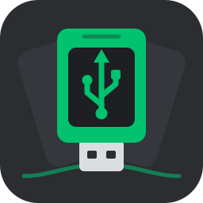

# USB Loader NX

Play your Nintendo Switch game dumps straight from a USB drive. 
An Atmosphère fork with a library manager in the spirit of USB Loader GX for the Wii.

[Features](README.md#features) · [Install](README.md#install) · [Configuration](README.md#configuration) · [Building](README.md#building) · [Architecture](ARCHITECTURE.md) · [README](README.md) · [TODO](TODO.md) · [License](README.md#license) · [Credits](README.md#credits)

Every release of USB Loader NX, newest first.

## v0.4.0 — 2026-11-21

### ✨ Features

- **fs_mitm:** Serve the ForBatchRead data storages of firmware 23 ([`94c93e8`](https://github.com/NedcloarBR/USB-Loader-NX/commit/94c93e82ea425a116a080cf00ca59f505a52f709) by @NedcloarBR)

### 📝 Documentation

- Point to the log in atmosphere/logs ([`4b51d83`](https://github.com/NedcloarBR/USB-Loader-NX/commit/4b51d838548937d17010cb9a6b846057e2b7023d) by @NedcloarBR)
- Mark firmware 23.5.0 as tested ([`2f3938a`](https://github.com/NedcloarBR/USB-Loader-NX/commit/2f3938ab5e3ccfb62294052c409f6e5b61613241) by @NedcloarBR)

**Full changelog:** [v0.3.0...v0.4.0](https://github.com/NedcloarBR/USB-Loader-NX/compare/v0.3.0...v0.4.0)

## v0.3.0 — 2026-11-20

### ✨ Features

- **usbl:** Log read statistics with usbloadernx!debug ([`76441d2`](https://github.com/NedcloarBR/USB-Loader-NX/commit/76441d2ed83d2419d01f40953b3fed13c6e6e0bd) by @NedcloarBR)

### ⚡ Performance

- **usbl:** Read contiguous clusters in 256 KB transfers ([`3d53c52`](https://github.com/NedcloarBR/USB-Loader-NX/commit/3d53c52fc1b9937337333fffe8820c825e8ecf63) by @NedcloarBR)
- **usbl:** Build a fragmented file's cluster map once per mount ([`f7268fd`](https://github.com/NedcloarBR/USB-Loader-NX/commit/f7268fdbdcb5947766f6fd0d4864dc08391f159d) by @NedcloarBR)
- **usbl:** Count the boot grace period from the USB host start ([`7fe9d30`](https://github.com/NedcloarBR/USB-Loader-NX/commit/7fe9d309e1bd2da917f876b257174d06b5271361) by @NedcloarBR)

### 📝 Documentation

- **todo:** Plan the performance work for 1.0.0 ([`473f1e8`](https://github.com/NedcloarBR/USB-Loader-NX/commit/473f1e88fe8985dd7de547f5854c92adf470ad94) by @NedcloarBR)
- **readme:** Say when the Build workflow runs ([`0f78c53`](https://github.com/NedcloarBR/USB-Loader-NX/commit/0f78c5353b861a3d81572b98234a16f95f4f9b93) by @NedcloarBR)
- **todo:** Mark the measured performance work ([`d85a706`](https://github.com/NedcloarBR/USB-Loader-NX/commit/d85a7068335574a95e426e0491fb465aa71ce6ec) by @NedcloarBR)

**Full changelog:** [v0.2.0...v0.3.0](https://github.com/NedcloarBR/USB-Loader-NX/compare/v0.2.0...v0.3.0)

## v0.2.0 — 2026-11-20

### ✨ Features

- **usbl:** Apply romfs mods and translations to USB games ([`3375cac`](https://github.com/NedcloarBR/USB-Loader-NX/commit/3375cac723ebb802de3e7a2856535ce994d08c52) by @NedcloarBR)

### 🐛 Fixes

- **usbl:** Serve an update only once the console has it registered ([`ef03f71`](https://github.com/NedcloarBR/USB-Loader-NX/commit/ef03f7179e864d01feeb2d91390c48a8477f77b0) by @NedcloarBR)
- **usbl:** Keep a running game's record when its drive is removed ([`fcdb78b`](https://github.com/NedcloarBR/USB-Loader-NX/commit/fcdb78ba164215bde80535a459df138b4e5223b4) by @NedcloarBR)

### 🏗️ Build and CI

- **build:** Run only when the build inputs change ([`20b9aeb`](https://github.com/NedcloarBR/USB-Loader-NX/commit/20b9aebc8eb97bf684bb95d742875593fcf1006c) by @NedcloarBR)

### 🔧 Other

- **github:** Add issue and pull request templates ([`b22da33`](https://github.com/NedcloarBR/USB-Loader-NX/commit/b22da33f2c3e8582df54b266e703ab5297161851) by @NedcloarBR)

**Full changelog:** [v0.1.0...v0.2.0](https://github.com/NedcloarBR/USB-Loader-NX/compare/v0.1.0...v0.2.0)

## v0.1.0 — 2026-11-20

### ✨ Features

- **usbl:** Add USB mass storage driver and volume manager ([`cdaf3d3`](https://github.com/NedcloarBR/USB-Loader-NX/commit/cdaf3d3fe100903b9ae9156fe01b2936f109e3f3) by @NedcloarBR)
- **usbl:** Decrypt NCAs with keys derived on demand ([`21ac1ae`](https://github.com/NedcloarBR/USB-Loader-NX/commit/21ac1aec3359f4f64f27f7f67c37b6ed984c68dc) by @NedcloarBR)
- **usbl:** Index XCI and NSP dumps found on USB ([`b1aeea0`](https://github.com/NedcloarBR/USB-Loader-NX/commit/b1aeea0e3ab7734d3009b0388a094521bee810b5) by @NedcloarBR)
- **ncm:** Query USB Loader NX for USB-served content ([`44206b5`](https://github.com/NedcloarBR/USB-Loader-NX/commit/44206b5a8c5c040d3080bb793a2d00db6bd954c2) by @NedcloarBR)
- **loader:** Mount code of USB-served programs ([`f9c3f85`](https://github.com/NedcloarBR/USB-Loader-NX/commit/f9c3f85a0f4358c4b89635892e2cd19cbc8f963b) by @NedcloarBR)
- **usbl:** Register USB titles with updates and DLC in ncm and ns ([`e8c2642`](https://github.com/NedcloarBR/USB-Loader-NX/commit/e8c264237cb9362b47e300b41d1380d206fbfcbf) by @NedcloarBR)
- **fs_mitm:** Serve USB content, titlekeys and DLC storage ([`cc927bc`](https://github.com/NedcloarBR/USB-Loader-NX/commit/cc927bc612f9f2bbaaf09cccbe7baae6e66aa558) by @NedcloarBR)
- **usbl:** Post Ultrahand notifications in pt-BR and en-US ([`ae9cc81`](https://github.com/NedcloarBR/USB-Loader-NX/commit/ae9cc81a9b0668661086569e62a9c58a134dd450) by @NedcloarBR)
- **usbl:** Badge icons of USB-served games ([`d577c4e`](https://github.com/NedcloarBR/USB-Loader-NX/commit/d577c4e5e1dc08742c3fbba476b83ffa7638d28b) by @NedcloarBR)
- **usbl:** Run as an ams.mitm module ([`cb7cde4`](https://github.com/NedcloarBR/USB-Loader-NX/commit/cb7cde4196cf40796335d170b5f827cd215f84e7) by @NedcloarBR)
- **usbl:** Tell sleep from removal through psc ([`958ba70`](https://github.com/NedcloarBR/USB-Loader-NX/commit/958ba70479c55acf16e570b0c7b552f591baf438) by @NedcloarBR)
- **usbl:** Add config.ini and usbloadernx system settings ([`4d9650b`](https://github.com/NedcloarBR/USB-Loader-NX/commit/4d9650bd4620fd4fc6cd3a9ca362fedbb3596ed1) by @NedcloarBR)
- **usbl:** Hide games from HOME per title ([`d07651e`](https://github.com/NedcloarBR/USB-Loader-NX/commit/d07651ecbca2664f91624fce360b01295146bd40) by @NedcloarBR)
- **usbl:** Report each game's size on the drive ([`7efdee6`](https://github.com/NedcloarBR/USB-Loader-NX/commit/7efdee6cd67a1c636c4090b6049ac03f3dde67ba) by @NedcloarBR)
- **usbl:** Apply HOME visibility options right away ([`b6f7160`](https://github.com/NedcloarBR/USB-Loader-NX/commit/b6f71601be2d9aab6ed9f0fecf9a2a24f4ad0348) by @NedcloarBR)
- **usbl:** Show a game on HOME just to launch it ([`88dc705`](https://github.com/NedcloarBR/USB-Loader-NX/commit/88dc7050035ead239ba113f4c42e2a3dc438bccd) by @NedcloarBR)
- **usbl:** Give the Manager plain icons and display versions ([`17ed142`](https://github.com/NedcloarBR/USB-Loader-NX/commit/17ed1428209ce3afc2fd6c89f72b3ea2f307ae59) by @NedcloarBR)
- **usbl:** Keep a game's update and DLC on its own drive ([`f7bbaf0`](https://github.com/NedcloarBR/USB-Loader-NX/commit/f7bbaf0caed190d6337c640f5813a790d635a458) by @NedcloarBR)
- **usbl:** Take a launched game off HOME once it closes ([`8388add`](https://github.com/NedcloarBR/USB-Loader-NX/commit/8388adde82949d1172c5d71402dc3e14bd9ba5cc) by @NedcloarBR)
- **usbl:** Show a badge change on HOME right away ([`4d0d5fe`](https://github.com/NedcloarBR/USB-Loader-NX/commit/4d0d5fe81c10268f39abf19ef09afa804cc2e226) by @NedcloarBR)
- **manager:** Add the USB Loader NX Manager ([`57a5124`](https://github.com/NedcloarBR/USB-Loader-NX/commit/57a512493637ddd03e47a3e7ad11e8d8a77e333f) by @NedcloarBR)

### 🐛 Fixes

- **manager:** Link the repository in About ([`4ceee33`](https://github.com/NedcloarBR/USB-Loader-NX/commit/4ceee338201cde7098bd8f6d3ba489813a72ef7c) by @NedcloarBR)

### 🧩 Atmosphère

- Update to 1.12.2 ([`af54443`](https://github.com/NedcloarBR/USB-Loader-NX/commit/af54443aa74fc1186c8d2dddc8543ab5a0c0968f) by @NedcloarBR)

### ♻️ Refactoring

- **usbl:** Share the usbl protocol between module and Manager ([`a3c1f91`](https://github.com/NedcloarBR/USB-Loader-NX/commit/a3c1f9116d0bf6bae50350ecc4a07be2d0da8a78) by @NedcloarBR)

### 📝 Documentation

- Add README, license, architecture notes and TODO ([`ae25820`](https://github.com/NedcloarBR/USB-Loader-NX/commit/ae25820c6fb5b961c4f20b903daa81665c8de9d6) by @NedcloarBR)
- Plan the Manager, themes, PC Manager and network loading ([`79afe0e`](https://github.com/NedcloarBR/USB-Loader-NX/commit/79afe0ed1daceb20dcf4dfa286073cd01b712ad4) by @NedcloarBR)
- **manager:** Add the Manager README ([`ca344e7`](https://github.com/NedcloarBR/USB-Loader-NX/commit/ca344e75628210c03b7c4cea0fc8678c02f026aa) by @NedcloarBR)

### 🏗️ Build and CI

- Compile src/ into the Atmosphère fork branch ([`b97d632`](https://github.com/NedcloarBR/USB-Loader-NX/commit/b97d632067ae5a8cd6b855ba4953f21ca2a528f3) by @NedcloarBR)
- Add build image, scripts and release workflows ([`6515f2f`](https://github.com/NedcloarBR/USB-Loader-NX/commit/6515f2f08c55f59761be8e7eda3c474b7381fd4c) by @NedcloarBR)
- **release:** Generate notes and CHANGELOG.md with git-cliff ([`9314334`](https://github.com/NedcloarBR/USB-Loader-NX/commit/9314334a3bd52396f0633a0ea8f1ae37cb7c1210) by @NedcloarBR)
- **release:** Let the Release workflow keep CHANGELOG.md ([`01ae0f4`](https://github.com/NedcloarBR/USB-Loader-NX/commit/01ae0f489d5eaee089efd1ef955e07c56c7c1bcd) by @NedcloarBR)
- **build:** Build the images with plain docker ([`ef3fe5b`](https://github.com/NedcloarBR/USB-Loader-NX/commit/ef3fe5b3b2a3b7f7b63b6ee35c87c329dc1eb34a) by @NedcloarBR)

### 🔧 Other

- **usbl:** Vendor FatFs R0.16 as read-only ([`d9abc2f`](https://github.com/NedcloarBR/USB-Loader-NX/commit/d9abc2fa3dc4b344ff70d6a3b75f069f82b8b875) by @NedcloarBR)
- **package:** Ship the release as SD and USB folders with a README ([`908d76f`](https://github.com/NedcloarBR/USB-Loader-NX/commit/908d76f9d43a9aa6fd97a19d7436be36ba5f3e26) by @NedcloarBR)

**Full changelog:** [v0.1.0](https://github.com/NedcloarBR/USB-Loader-NX/commits/v0.1.0)

