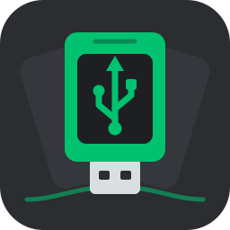

<div align="center">



# USB Loader NX

Play your Nintendo Switch game dumps straight from a USB drive.<br>
An Atmosphère fork with a library manager in the spirit of USB Loader GX for the Wii.


[Features](#features) · [Install](#install) · [Configuration](#configuration) · [Building](#building) · [Architecture](ARCHITECTURE.md) · [TODO](TODO.md) · [License](#license) · [Credits](#credits)

</div>

Games are never copied to the SD card or the console: USB Loader NX reads them from the drive while you play. Plug the drive into the dock and your games appear on the HOME menu.

## Features

| | |
|---|---|
| **Formats** | XCI (game card dumps) and NSP (eShop), with their updates and DLC, from exFAT or FAT32 drives |
| **HOME menu** | Games show up like installed ones, with a badge marking where they come from |
| **eShop content** | Titlekeys come from the console's own `es` service, no `prod.keys` needed |
| **Newer games** | The firmware a game asks for is dropped on registration, like DBI does |
| **Several drives** | At once, and they survive sleep without notifications or a HOME refresh |
| **Hiding** | Hide games while their drive is unplugged, or single games from the Manager |
| **Notifications** | Ultrahand notifications when a drive is connected or removed, in English and Brazilian Portuguese |
| **Manager** | `USBLoaderNX-Manager.nro`: library, launch, show or hide on HOME, drive usage and settings |
| **Safety** | The USB drive is mounted read-only |

What comes next, from compressed dumps to installing to USB, is in [TODO.md](TODO.md).

> [!NOTE]
> Tested on a Switch (Mariko) in the dock. The USB-C port with an OTG adapter should work as well, and so should the Switch Lite, but neither has been tested yet.

## Install

1. Download `usb-loader-nx-<version>.zip` from the releases and copy its contents to the root of the SD card.

   > [!WARNING]
   > The zip holds a complete Atmosphère. Merge it with your existing `atmosphere/` folder instead of replacing it, so sys-patch and your other mods stay in place.

2. Enable the module in `atmosphere/config/system_settings.ini`:

   ```ini
   [usbloadernx]
   enable = u8!0x1
   ```

3. Put your dumps in `usbloadernx/games/` on the USB drive and plug it in. Subfolders one level deep are scanned too.

## Configuration

| File | What it holds |
|---|---|
| `atmosphere/config/system_settings.ini` | `enable`, and `debug` for extra diagnostics in the log |
| `atmosphere/config/usbloadernx/config.ini` | Everyday options, created with the defaults on first boot and edited by the Manager |
| `atmosphere/config_templates/usbloadernx.ini` | Every option of `config.ini`, documented |
| `atmosphere/config/usbloadernx/usbloadernx.log` | What USB Loader NX did: drives, games, registration, errors |

## Building

Requires Docker.

```sh
git clone --recurse-submodules <repository>
scripts/build-image.sh     # once: builds the atms-build-libnx image
scripts/build.sh           # Atmosphère with USB Loader NX, and the Manager
scripts/package.sh         # dist/usb-loader-nx-<version>.zip, ready for the SD card
```

The version comes from the closest `v*` tag (`git describe`), or `USBL_VERSION` when set.

How the repository is organized, and where changes go, is in [ARCHITECTURE.md](ARCHITECTURE.md).

## Updating Atmosphère

```sh
scripts/update-atmosphere.sh 1.13.0     # rebases the hook commits onto the new upstream tag
scripts/build.sh                        # build and test on the console
git -C atmosphere push --force-with-lease origin atmosphere
git add atmosphere ATMOSPHERE_VERSION
git commit -m "chore(atmosphere): update to 1.13.0"
```

A conflict stops the rebase inside `atmosphere/`, on the hook that no longer applies. Upstream tags are fetched into `refs/upstream/tags/` and never pushed, so they do not mix with our releases.

## Releases

Push a `v*` tag on `master`, for example `v0.1.0`. A tag with a `-`, like `v0.2.0-beta.1`, makes a pre-release. The Release workflow builds everything and publishes `usb-loader-nx-<tag>.zip`, noting the Atmosphère version it is based on. Every push and pull request is built by the Build workflow.

## License

USB Loader NX © 2026 NedcloarBR. Based on Atmosphère © Atmosphère-NX.

USB Loader NX is a fork of [Atmosphère](https://github.com/Atmosphere-NX/Atmosphere) and is licensed, like it, under the **GNU General Public License, version 2** (see [LICENSE](LICENSE)). If you share a build with anyone, share the matching source code with it.

### Third-party code

| Component | Used for | License | Where |
|---|---|---|---|
| [Atmosphère](https://github.com/Atmosphere-NX/Atmosphere) | The custom firmware this fork extends | GPLv2 | `atmosphere/` |
| [FatFs](http://elm-chan.org/fsw/ff/) R0.16 | Reading exFAT and FAT32 drives | FatFs license (BSD-style) | `src/ams_mitm/usbl/fatfs/` |
| [stb_image](https://github.com/nothings/stb) and stb_image_write | Drawing the badge on game icons | MIT or public domain | `src/ams_mitm/usbl/third_party/stb/` |
| [Plutonium](https://github.com/XorTroll/Plutonium) | The Manager's user interface | MIT | `manager/lib/Plutonium/` |

Each component keeps its license file or header in the folder listed.

### Credits

[USB Loader GX](https://github.com/wiidev/usbloadergx) for the Wii is the inspiration for this project: like it, USB Loader NX lets you play your own game dumps straight from a USB drive, and the Manager's carousel, channel grid and Wii-menu-style dock follow its look. No code, artwork or sound from it is used.

### Legal

USB Loader NX is for game dumps you made from games you own. It ships no keys, firmware or game content.

Nintendo Switch is a trademark of Nintendo. This project is not affiliated with or endorsed by Nintendo, the Atmosphère team or the authors of USB Loader GX.
