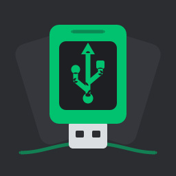

<div align="center">



# USB Loader NX Manager

The homebrew app of [USB Loader NX](../README.md): your USB games as a shelf, a grid, covers, a Cover Flow of cases, shelves by folder or genre, or a list, with play time, favorites, search, drive usage and the settings.

[Using it](#using-it) · [Settings](#settings) · [Files on the SD card](#files-on-the-sd-card) · [Themes](themes/README.md) · [Translations](#translations) · [Building](#building) · [Code](#code)

</div>

`USBLoaderNX-Manager.nro` talks to the USB Loader NX module through its `usbl` service, so it needs the Atmosphère of this project running. Without it, it says the service is not active and how to turn it on.

## Using it

Open it from the homebrew menu (the Album).

| Screen | What it shows |
|---|---|
| **Shelf** | The selected game large, the next ones queued after it (without names) with their reflection; under it the drive, version, DLC, size, play time and anything that needs attention |
| **Grid** | Five covers a row, names on up to two lines, a badge on games whose drive is unplugged or whose update is missing or on another drive |
| **Covers** | GameTDB's front covers in rows, the selected game's name under them |
| **Cases** | Cover Flow: the selected case facing you, the others turned away on both sides, all with their reflection (GameTDB's cases, else covers, else icons); its name and details under it |
| **Shelves** | One shelf per subfolder of `usbloadernx/games/` (the root as Games, installs as Installed), or per GameTDB genre (Settings), the games' spines side by side and the selected one's cover |
| **List** | One row per game: icon, name, drive, version, size and play time |
| **Game details** | Cover (GameTDB's, turned over with ZR to its back, and the game card next to it for XCI) or icon, format and drive; developer, publisher, year, genres, players, play modes and age rating from GameTDB; version, update, DLC, size, file fragmentation, play time and last played; Launch and Hide from / Show on HOME |
| **USB drives** | Each drive's name, file system, games, updates and DLC, free space, and a usage bar that turns from green to red as it fills; with several drives, A shows only the focused drive's games. L / R: statistics (games, space and time played, the five most played and the five largest) |
| **Settings** | HOME Menu, Manager and About sections |

| Button | Action |
|---|---|
| Left / Right | Pick a game (Up / Down too on the grid and covers; on the shelves, Up / Down change shelf) |
| A | Shelf and cases: launch the game. Other views: open its details |
| Down | Shelf: move to the Launch and Details buttons (Up or B goes back) |
| L / R | Previous or next view (covers, cases and shelves while Covers from GameTDB is on; a theme can offer fewer) |
| Y | USB drives and statistics; in a game's details, add to or remove from favorites |
| ZR | Which games show: all, continue playing (the last six played), favorites, each drive, XCI / XCZ, NSP / NSZ, installed, hidden from HOME; in a game's details, turn its cover over |
| Touch | Tap a game to pick it, tap the picked one to launch it or open its details; swipe to move through the games |
| X | Change the order: name, recently played, most played, size |
| ZL | Search by name with the console's keyboard (B clears the search) |
| L / R in a game's details | Previous or next game |
| + | Settings |
| − | Exit |

Favorites come first in every order. A game hidden from HOME, or every game while "Show USB games on the HOME Menu" is off, can still be launched here: it shows on HOME while it runs and leaves again once it is closed.

When a game was already played with an update that is no longer on its drive, the console asks for that version: the Manager says so before launching instead of letting HOME offer a download.

## Settings

| Section | Option | Kept in |
|---|---|---|
| HOME Menu | Show USB games on the HOME Menu | the module's `config.ini` |
| HOME Menu | Hide games while their drive is unplugged | the module's `config.ini` |
| HOME Menu | Homebrew access to each USB drive's `usbloadernx/usb/` (read-only, at `sdmc:/usbloadernx/usb/<volume serial>/`); needs USB Loader NX 1.1 | the module's `config.ini` |
| HOME Menu | USB badge on icons (HOME shows the change as soon as it comes to the front) | the module's `config.ini` |
| HOME Menu | Notifications (Ultrahand) | the module's `config.ini` |
| Manager | Language of the Manager and of the notifications: the system's, English or Português (Brasil); needs USB Loader NX 1.1 | the module's `config.ini` (`language`) |
| Manager | Sound effects | `manager.ini` |
| Manager | Theme, picked from a list with a large preview, its author, version and what it changes | `manager.ini` |
| Manager | Theme music, and its volume (0 to 100 %) | `manager.ini` |
| Manager | Game backdrop: the selected game's cover or icon, blurred, behind the home screen | `manager.ini` (`game_backdrop`) |
| Manager | Shelves by folder or by GameTDB genre | `manager.ini` (`shelves_by_genre`) |
| Manager | Covers from GameTDB: covers, cases, opened covers and game cards downloaded from `art.gametdb.com` for the games on the drives (off by default) | `manager.ini` (`gametdb_art`) |
| Manager | Game art: a window with how many games have a cover, the ones without and why (not on GameTDB, GameTDB has no cover, no internet, the download failed), **Download what is missing** and **Delete the art** | — |

### Covers from GameTDB

The Manager's only use of the network, off until it is turned on. The details in a game's window (developer, year, genres...) and the shelves by genre need no network: they come from the same index. GameTDB knows games by its own codes, not by title id, so a game is matched by its names (in every language its control data has) against an index of GameTDB's database built into the app (`romfs/gametdb/index.bin`, made by `tools/gametdb/build_index.py`), preferring the console's region. Only that code goes to `art.gametdb.com`, over HTTPS checked against Let's Encrypt's roots (`romfs/certs/gametdb.crt`). A wrong match can be fixed in `data/gametdb.ini`: `<application id> = <GameTDB id>` under `[gametdb]`; the game's art is downloaded again.

## Files on the SD card

Everything the Manager writes is under `sdmc:/usbloadernx/`, next to the module's files (see [FORMATS.md](../FORMATS.md)):

| File | What it holds |
|---|---|
| `manager.ini` | `sounds`, `sort`, `view`, `theme`, `music`, `music_volume`, `game_backdrop`, `shelves_by_genre` and `gametdb_art` under `[manager]` |
| `data/favorites.ini` | `<application id> = 1` under `[favorites]` |
| `data/gametdb.ini` | The player's own GameTDB matches, read only |
| `cache/icons/` | The games' own icons (without the HOME badge), kept for when their drive is unplugged |
| `cache/art/` | GameTDB's art, `cover/`, `box/`, `spread/` and `cart/` with `<application id>.jpg/png`, and `state.ini`: each game's GameTDB code and what GameTDB did not have (asked again after a week) |
| `themes/<name>/` | Installed themes, see [themes/README.md](themes/README.md) |

On start, the Manager checks the system before showing the library:

| What it finds | What it shows |
|---|---|
| An Atmosphère without USB Loader NX | Its version and commit, and to install the package over it |
| `[usbloadernx] enable = u8!0x0` | Which file to change for the boot option in use, and **Turn on and restart**, which writes `enable = u8!0x1` there (keeping a `.bak` copy) and restarts the console |
| USB Loader NX on but not running | Where its log is |
| USB Loader NX and the Manager from different packages | Which one is older and what to copy from the package; nothing is written |
| Files written by a newer version | That they are read but not changed; **Write anyway** lets this version save `config.ini` again |

The boot option's file is found by content: packs like CNX copy it (`cfw_system_settings.ini`, `stock_system_settings.ini`…) over `system_settings.ini` at every boot, so the file in `atmosphere/config/` with the very same content is the one to edit.

It writes `atmosphere/config/*system_settings*.ini` only through **Turn on and restart**.

It also reads the console's play records (`pdm`) for play time and the launch version (`avm`) to warn about a missing update; neither is written.

## Translations

The text is in `romfs/i18n/<locale>.json` (`en-US` and `pt-BR` today), one section per screen and `{{NAME}}` placeholders. English is loaded first, then the console's language, so a missing key falls back to English. A new language is one more file with the same keys, built into the app.

## Building

From the repository root, with the build image from the main README:

```sh
scripts/build.sh manager     # manager/USBLoaderNX-Manager.nro
```

The icon (`icon.jpg`, also in `romfs/`), the sound effects (`romfs/sfx/`) and the Midnight theme's background, preview and music are made by the scripts in `tools/assets/`.

## Code

Written with [Plutonium](https://github.com/XorTroll/Plutonium) (`lib/Plutonium`, submodule). The design is laid out at 1280x720 and scaled to the screen; every shape is drawn antialiased.

| File | What it does |
|---|---|
| `source/main.cpp` | Renderer options, and telling the module when HOME comes to the front |
| `source/main_application.cpp` | Screens, polling the module for drive changes, launching, sort and search |
| `source/game_library.cpp` | The games: status from the module, names and icons, play time, favorites, the launch version check |
| `source/gametdb.cpp` | Matching a game to GameTDB by its names |
| `source/art.cpp` | Downloading GameTDB's art (libcurl) and its textures |
| `source/usbl_client.cpp` | The `usbl` service commands (`common/include/usbl/protocol.hpp`) |
| `source/ui/library_screen.cpp` | Shelf, grid, covers, cases, shelves, game details, USB drives and messages |
| `source/ui/settings_screen.cpp` | Settings, the theme picker and the music volume slider |
| `source/ui/theme.cpp` | Theme loading (`theme.json`): palette, layout, images, fonts |
| `source/ui/animated_image.cpp` | Animated GIF (giflib) and WebP (libwebp) backgrounds, one frame at a time |
| `source/ui/draw.cpp` | Antialiased shapes, the focus ring, the usage bar and the icons |
| `source/ui/widgets.cpp` | Text that fits, wrapping, button hints |
| `source/sound.cpp` | Sound effects and theme music (SDL_mixer) |
| `source/strings.cpp` | The translations |
| `source/manager_settings.cpp` | `manager.ini` |

## License

GPLv2, like the rest of USB Loader NX. Plutonium is MIT.
